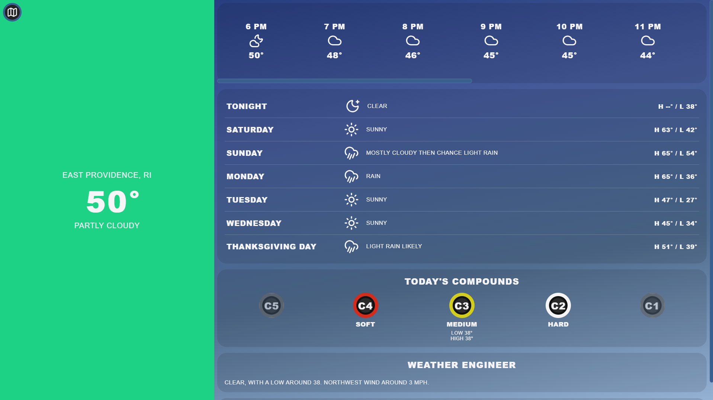
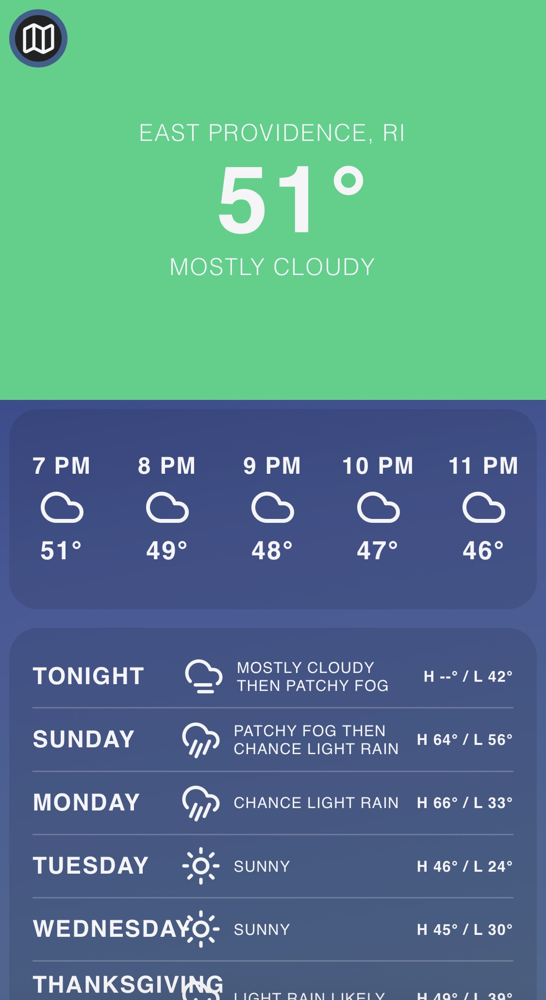

# Formation Weather

F1 inspired weather app with condition based flag alerts.

## Features 
- Location changing 
- 4 flag types 
- outfit type suggester 
- PWA installable 
- 7 day and 12 hour forecast 
- detailed forecast information
## Run Locally

Clone the project

```bash
  git clone https://github.com/FencingLefty3/Formation
```

Go to the project directory

```bash
  cd Formation
```

Start the server

```bash
  python -m http.server
```


## PWA

Try on the site, or install the pwa.

[formation.fencinglefty.com](formation.fencinglefty.com)

## Screenshots





## Appendix

US only, data from api.weather.gov

